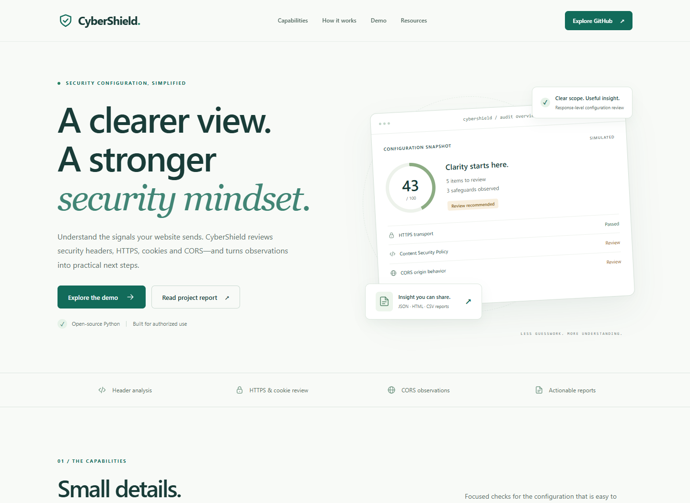

# CyberShield

A small Python website configuration auditor with a local Streamlit dashboard and an interactive GitHub Pages demonstration.

[Explore the static demo](https://shekhawatgaurav.github.io/cybershield/) ? [Repository](https://github.com/shekhawatgaurav/cybershield) ? [Academic report](cybershield-project-report.pdf)

The public demo uses **simulated findings only**. It never accepts target URLs or performs scans. Use the Python tool locally, only against a website you own or are explicitly authorized to assess.



[Mobile landing page](docs/assets/landing-mobile.png) / [Interactive audit dashboard](docs/assets/dashboard-desktop.png)

## Objectives

- Make response-level security configuration understandable and reproducible.
- Identify observable header, HTTPS, CORS and cookie configuration concerns.
- Provide severity-based review priorities and practical recommendations.
- Demonstrate an ethical, bounded audit workflow with offline tests and portable reports.

## Features

- HTTPS transport observation with normal certificate verification for live connections.
- HSTS max-age, CSP presence, MIME sniffing protection, framing controls, referrer and permissions policy observations.
- Optional CORS probe using one synthetic Origin; distinguishes credentialed reflection from browser-rejected wildcard combinations.
- Cookie Secure, HttpOnly and SameSite checks, including invalid SameSite values and None without Secure. Cookie values are omitted from reports.
- Public-address checks, same-host/www redirect scope, three-redirect limit and eight-second socket timeout.
- JSON and self-contained HTML reports, severity labels and recommendations.
- Local Streamlit dashboard with authorization confirmation and an offline demo.
- Light-themed landing page with capabilities, workflow, methodology, resources and accessible FAQs.
- Responsive static dashboard: three fictional website fixtures with before/after configurations, score chart, severity bars, searchable header filters, CORS/cookie observations, a guided demo audit, JSON/HTML/CSV downloads and print-to-PDF.

## Technology and architecture

Python 3.10+; standard-library HTTP/TLS, JSON and unittest; Streamlit for the local UI; HTML, CSS and plain JavaScript for Pages. No database, API key, paid service, frontend framework or build service is required.

```text
Local CLI / Streamlit authorization
              |
     URL + public DNS validation
              |
  GET headers + bounded redirects
              |
   Optional single Origin probe
              |
 Header / HTTPS / CORS / cookie review
              |
   Heuristic score + JSON / HTML

Python offline fixtures --> tools/build_demo.py --> docs/demo-data.js
                                                   |
                                      Browser-only static dashboard
```

The scanner never reads response bodies. A GET still contacts the target and may have server-side effects; use an appropriate, authorized page. There are at most five HTTP requests: the initial request, three redirects and one optional probe. DNS checks are additional lookups, and the socket timeout is not a total scan deadline.

## Run locally

In PowerShell, from the project directory:

```powershell
python -m venv .venv
.venv\Scripts\python.exe -m pip install -r requirements.txt
.venv\Scripts\python.exe -m streamlit run app.py
```

Open `http://127.0.0.1:8501`. Select **Explore offline demo**, or enter your authorized public URL, confirm permission and select **Run authorized audit**. The repository configuration binds Streamlit to loopback. Alternatively, double-click `launch_windows.bat`.

The scanner and CLI need no third-party packages:

```powershell
python -m cybershield.cli --demo
python -m cybershield.cli --demo --format html --output demo-report.html
python -m cybershield.cli --url https://your-owned-site.example --authorized
python -m cybershield.cli --url https://your-owned-site.example --authorized --skip-cors --format json --output audit.json
```

Replace the example URL with your explicitly authorized target. Live CLI scans require `--authorized`. Exit status is 0 on completion and 2 for invalid arguments or an audit/export error. `scan()` is a library API: callers are responsible for obtaining authorization.

`demo_app.py` preserves the original optional Streamlit demo and only uses offline fixtures. GitHub Pages needs neither Streamlit app.

## GitHub Pages demo

Source: **main**, directory **/docs**, entry point **docs/index.html**.

[Open CyberShield](https://shekhawatgaurav.github.io/cybershield/). The static demo works without a Python backend. Assets use relative paths, with no CDN, analytics, external font or runtime API dependencies. Scores and findings come from generated Python fixtures; switching scenarios makes no network request. Results remain hidden until **Run demo audit** is pressed. A short, explicitly simulated sequence reveals headers, CORS/cookies, recommendations and the score in stages. Downloads and printing become available on completion; changing the sample clears the previous results.

To preview locally:

```powershell
python -m http.server 8765 --bind 127.0.0.1 --directory docs
```

Open `http://127.0.0.1:8765`. You can also open `docs/index.html` directly. Deployment settings and troubleshooting are in [DEPLOY_LIVE.md](DEPLOY_LIVE.md).

Regenerate the sample data after changing assessment logic:

```powershell
python tools/build_demo.py
```

The fixture date is fixed for reproducibility, not a real scan timestamp. The baseline has score 43 (D), 5 warnings, 3 passed observations and 1 informational observation. The improved original fixture has score 100 with 9 passed observations. Additional fictional websites are Northstar Store (`shop.northstar.example/checkout`, scores 53/95) and Orbit Docs (`docs.orbit.example/guides/getting-started`, scores 95/100). The store retains a context-dependent JavaScript-readable preferences-cookie warning; the public documentation fixture intentionally allows non-credentialed wildcard CORS and sets no cookies. All are simulated; none establishes real website security.

## Tests and verification

```powershell
# Standard library only: scanner/CLI tests, with dashboard tests skipped
python -m unittest discover -s tests -v

# All 29 tests, including both dashboard tests
.venv\Scripts\python.exe -m unittest discover -s tests -v
.venv\Scripts\python.exe -m compileall -q app.py demo_app.py cybershield tests tools
.venv\Scripts\python.exe -m pip check

# Optional JavaScript syntax checks, when Node.js is installed
node --check docs/app.js
node --check docs/demo-data.js
```

All test targets are synthetic or mocked. No real website was audited during verification. See [VERIFICATION.md](VERIFICATION.md) for actual local results and browser coverage. GitHub Actions runs the offline suite on Python 3.10, 3.12 and 3.14, checks generated data and JavaScript syntax, and runs dashboard tests on Python 3.12 with Streamlit installed.

## Repository structure

```text
.github/workflows/tests.yml     Python, dashboard and static checks
.streamlit/config.toml         Local binding and dark theme
app.py                         Local authorized scanner dashboard
demo_app.py                    Optional offline Streamlit demo
cybershield/                    scanner.py, cli.py, reports.py
cybershield-project-report.pdf Original report plus release addendum
docs/                          index.html, styles.css, app.js,
                               demo-data.js, .nojekyll, assets/
examples/                      Example HTML and JSON reports
tests/                         Scanner, regression and dashboard tests
tools/build_demo.py             Reproducible fixture/report generation
project-report-addendum.html    Printable source of the PDF addendum
README.md                      Project guide
DEPLOY_LIVE.md                  GitHub Pages setup
VERIFICATION.md                 Recorded local validation
requirements.txt               Streamlit only
launch_windows.bat             Windows setup and launcher
LICENSE                        MIT license
```

`.venv`, `.local-tools`, `.local-backup`, generated caches, local reports and secrets are ignored. The original project backup remains locally in `.local-backup/original-project.zip` and is not published.

## Scoring and limitations

Start at 100; subtract 17 for each HIGH warning, 10 for MEDIUM and 5 for LOW, down to zero. INFO is not penalized. Grades: A ?90, B ?75, C ?60, D ?40, F <40. The score is an educational heuristic, not a calibrated risk measure.

| Observation | Limitation |
| --- | --- |
| HTTPS and HSTS | No cipher-suite, certificate-expiry or whole-site TLS audit |
| CSP and browser policies | Presence is not proof that policy directives are effective |
| CORS reflection | One unauthenticated response; no proof of sensitive data exposure |
| Cookie attributes | Purpose-dependent exceptions; no authenticated session testing |
| Public destination validation | DNS rebinding remains possible; keep the scanner local |
| Redirects and page selection | Final response only; redirect cookies and other routes are not assessed |

A failed optional CORS request leaves the main audit available and marks CORS undetermined. Non-success HTTP responses still describe the observed response, which may be an error page. No SQL injection, XSS, BOLA, password testing, exploitation, discovery or OWASP Top 10 coverage is claimed.

## Academic demonstration

1. Explain the scope and the distinction between the Python auditor and the static simulation.
2. Run the offline tests, open the Pages dashboard and compare the two sample scenarios.
3. Filter the header observations and show a CORS recommendation and exported JSON.
4. Run the local Streamlit offline demo and download an HTML report.
5. Review the source, methodology and limitations in the PDF. Its opening addendum records the updated release; the original pages are preserved as historical documentation.

## Ethical use

Audit only systems you own or have explicit permission to assess. Keep the scanner on your local machine. Observations require application context and manual review; do not present missing headers, synthetic findings or a heuristic score as confirmed vulnerabilities or security certification.

## References

- [OWASP HTTP Headers Cheat Sheet](https://cheatsheetseries.owasp.org/cheatsheets/HTTP_Headers_Cheat_Sheet.html)
- [MDN Set-Cookie](https://developer.mozilla.org/en-US/docs/Web/HTTP/Reference/Headers/Set-Cookie)
- [MDN Access-Control-Allow-Credentials](https://developer.mozilla.org/en-US/docs/Web/HTTP/Reference/Headers/Access-Control-Allow-Credentials)
- [GitHub Pages publishing sources](https://docs.github.com/en/pages/getting-started-with-github-pages/configuring-a-publishing-source-for-your-github-pages-site)

MIT license. No college, student identity or real-world audit result is asserted by this project.
